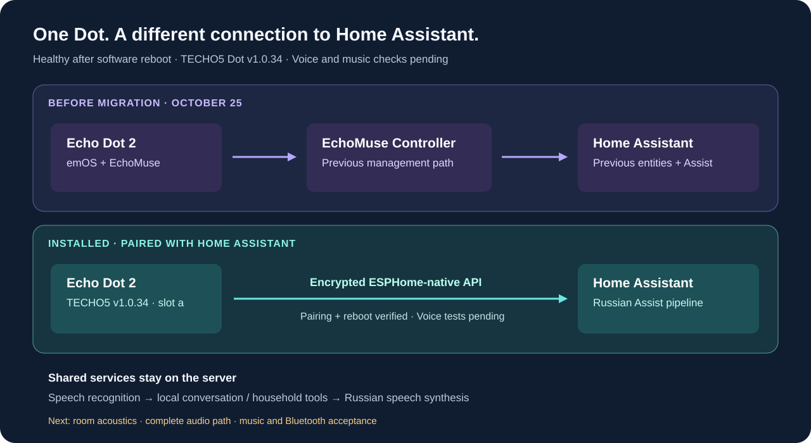

# HA · TECHO5 Dot

**Both Echo Dot 2 units now run TECHO5 and connect directly to Home Assistant. Administrative checks pass; voice and music listening tests remain separate.**

[English](README.md) · [Русский](README.ru.md) · [Deutsch](README.de.md) · [Español](README.es.md) · [Français](README.fr.md)

This repository records compatibility decisions, private preparation and acceptance checks. It does not replace upstream firmware or contain device credentials, recordings, model weights or unlocking tools.



## Where we are

Both Dots now run **TECHO5 v1.0.40 after the October 29 signed OTA update**. The October 28 migration preserved the personal wake model, paired the remaining unit with encrypted ESPHome, updated its dashboard and music routes, and removed its obsolete EchoMuse registrations. A software reboot passed. Fresh Bluetooth reports were received from both physical Dots. End-to-end voice/music tests remain pending; see the dated [status](docs/status.md).

The personal TFLite model has loaded in the openWakeWord engine. Its unique selector label is **«Привет, Мышка (personal)»**; the spoken phrase remains **«Привет, Мышка»**. The verified threshold is **0.5**, with no second wake word. Both Assist pipeline selectors use **Local Russian Home**; BLE proxy and streamed replies are enabled. These settings do not establish acoustic recognition, smooth playback or early audible replies.

The initial installation and classifier-parity baseline is [TECHO5 Dot v1.0.34](https://github.com/HuskerMinion/techo5-dot/releases/tag/dot-v1.0.34), pinned to [`88b2670`](https://github.com/HuskerMinion/techo5-dot/tree/88b26703d5e1a97d5ce0fee90805e8a3dd206a95). See [upstream-lock.json](upstream-lock.json) for those original source pins and [the deployment status](docs/status.md) for current deployed releases. Moving upstream `main` is not a deployment pin.

## Why evaluate it?

TECHO5 combines direct ESPHome-native Home Assistant connectivity, seven-microphone averaging, Bluetooth audio/proxy, Sendspin and signed updates with A/B rollback. Direct encrypted pairing is confirmed; the remaining capabilities still need acceptance on our hardware. It still uses Home Assistant's speech and conversation services; changing satellite firmware does not eliminate slow server-side inference.

The author’s report of three Dot 2 units in daily use informed our initial single-device trial. The second migration was explicitly requested after that pilot; installation checks do not replace acoustic acceptance. [Upstream status](https://github.com/HuskerMinion/techo5-dot/blob/88b26703d5e1a97d5ce0fee90805e8a3dd206a95/README.md#L62-L65)

## Follow the pilot

1. Check [device compatibility and migration boundaries](docs/migration.md).
2. Review [the custom wake word](docs/wake-word.md); the source ONNX model requires conversion to OWW TFLite and is not a drop-in microWakeWord model.
3. Review [Home Assistant integration](docs/home-assistant.md).
4. Complete [acceptance checks](docs/acceptance.md) for each deployed unit.

Read [SECURITY.md](SECURITY.md) before handling private material and [THIRD_PARTY.md](THIRD_PARTY.md) for upstream attribution. This is an independent homelab project, not an Amazon or TECHO5 endorsement.

## Local verification

Python 3.11+ can run the standard-library checks:

```sh
python3 -m unittest discover -s tests -v
python3 scripts/check_docs.py
python3 scripts/check_public.py --include-untracked
```

Verify a downloaded official asset without executing it:

```sh
python3 scripts/verify_assets.py private/releases/dot-v1.0.34/echod-arm-dot
```

Personalized model conversion has separate optional dependencies and regression
checks described in the [wake-word guide](docs/wake-word.md).

Repository creation and shared CI policy are described in [repository governance](docs/repository-governance.md).
